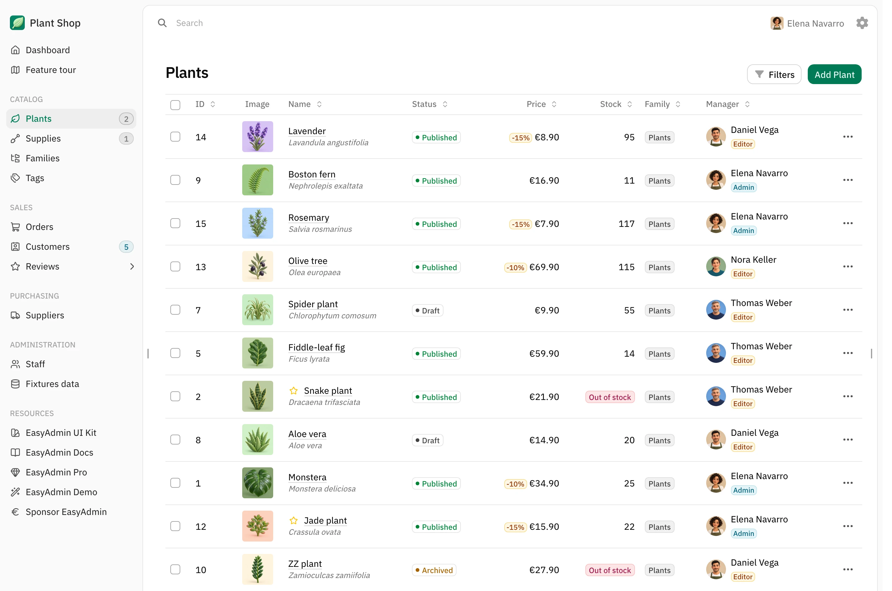

EasyAdmin Demo Application
==========================

This project is the official [EasyAdmin][1] Demo application that showcases the
main features of EasyAdmin, a popular admin generator for [Symfony][2] applications.

<p align="center">
    <a href="./doc/screenshots/index-light.webp" target="_blank">
        <picture>
            <source media="(prefers-color-scheme: dark)" srcset="./doc/screenshots/index-dark.webp">
            <source media="(prefers-color-scheme: light)" srcset="./doc/screenshots/index-light.webp">
            
        </picture>
    </a>
</p>

Requirements
------------

  * PHP 8.4 or higher;
  * PDO-SQLite PHP extension enabled;
  * and the [usual Symfony application requirements][3].

Installation
------------

Run this command with [Composer][4]:

```bash
$ composer create-project easyCorp/easyadmin-demo my_project
```

Usage
-----

There's no need to configure anything to run the application. If you have
[installed Symfony CLI][5], run this command:

```bash
$ cd my_project/
$ symfony serve
```

Then access the application in your browser at the given URL (<https://localhost:8000> by default).

If you don't have the Symfony binary installed, run `php -S localhost:8000 -t public/`
to use the built-in PHP web server or [configure a web server][6] to run the application.

What's Inside
-------------

The demo is the backend of a small plant shop: products, families, tags,
suppliers, customers, orders and reviews.

  * You start logged in as the admin user. The dashboard lets you switch with
    one click to the other demo users (an editor and a reader) to see how
    permissions change the backend, or log out to browse it as an anonymous visitor;
  * The **Feature tour** page lists the EasyAdmin features used in the demo. For
    each one, you can see it working, read the code that implements it and open
    its documentation;
  * The **View source code** button of each listing shows the code of the CRUD
    controller that builds that page;
  * The **Fixtures data** page (only for admins) restores the original data
    whenever you want.

Contributing
------------

This demo application is open source but it does not accept pull requests with
unsolicited features. If you have a feature idea, create an issue to discuss it
before implementing it. Pull requests that fix bugs are welcome.

License
-------

This demo application is published under the MIT license. See LICENSE.md for details.

[1]: https://github.com/EasyCorp/EasyAdminBundle/
[2]: https://symfony.com
[3]: https://symfony.com/doc/current/setup.html#technical-requirements
[4]: https://getcomposer.org/
[5]: https://symfony.com/download
[6]: https://symfony.com/doc/current/setup/web_server_configuration.html
